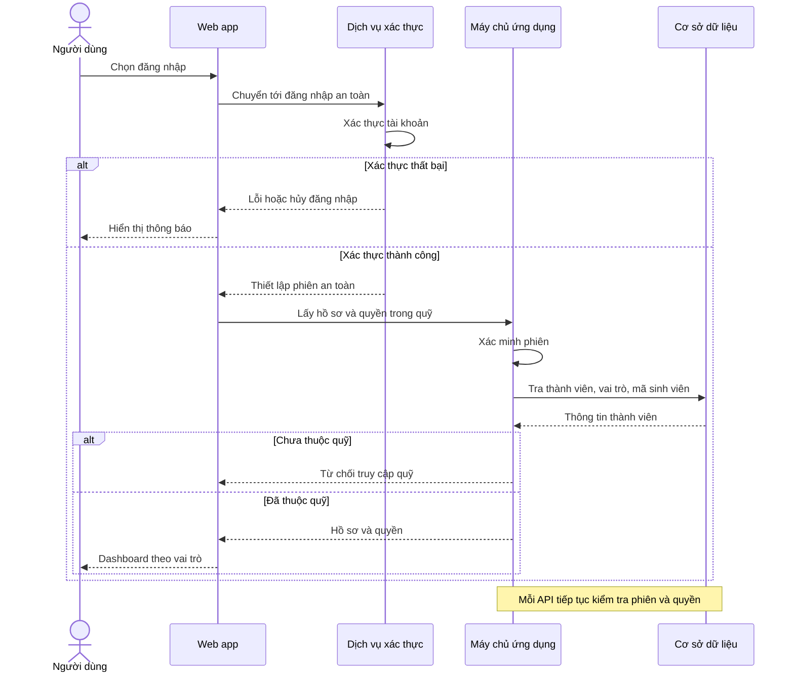
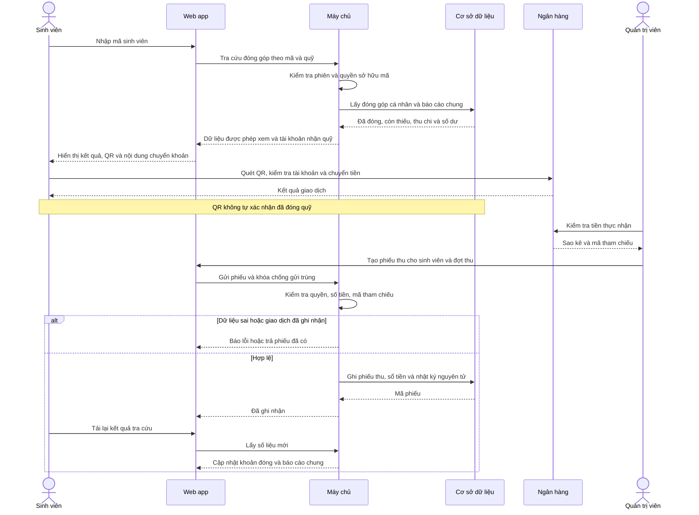
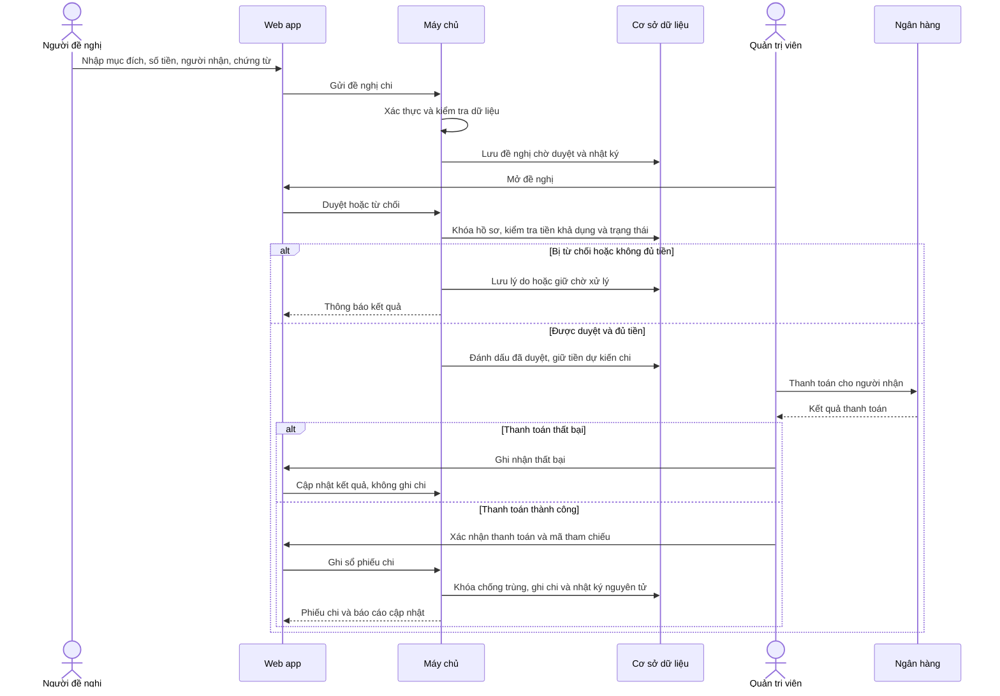
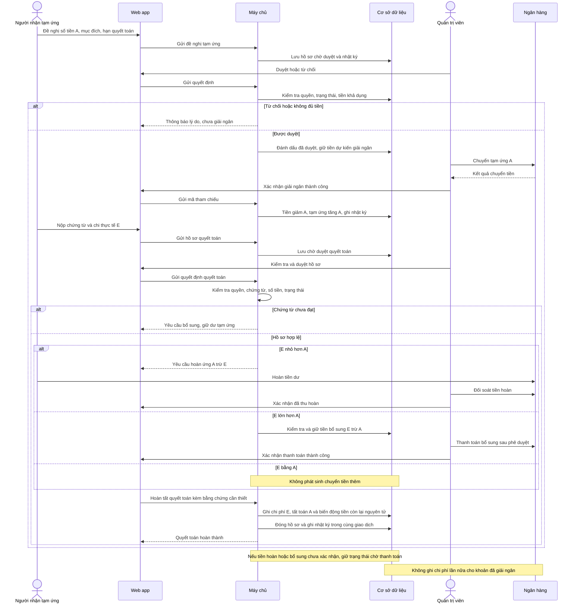
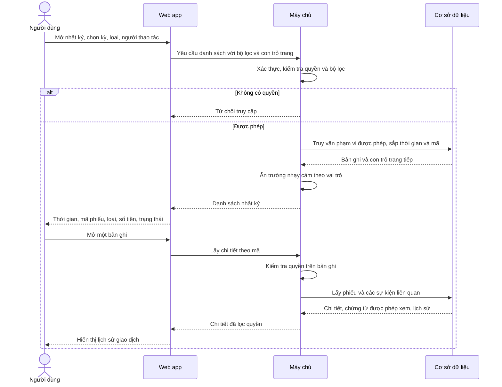

# Đồng Quỹ — Đặc tả chức năng và luồng nghiệp vụ

> Đây là đặc tả gốc trước khi triển khai Back end. Xem [TIEN-DO.md](TIEN-DO.md) và [README.md](README.md) để biết chức năng đã triển khai và hướng dẫn chạy hiện tại.

## 1. Phạm vi và trạng thái

Bản mẫu hiện tại dùng dữ liệu minh họa và localStorage. Chọn vai trò chỉ mô phỏng đăng nhập; không có máy chủ, tài khoản thật, kiểm tra quyền thật, tích hợp ngân hàng hoặc nhiều người dùng đồng bộ. Các Sequence Diagram dưới đây là thiết kế hệ thống triển khai thực tế. Luồng tạm ứng là đề xuất mới, chưa có chức năng trong bản mẫu.

## 2. Toàn bộ chức năng theo nhóm

| Nhóm | Chức năng | Vai trò | Trạng thái |
|---|---|---|---|
| Đăng nhập | Chọn tài khoản quản trị viên/sinh viên, đổi vai trò | Cả hai | Có mô phỏng |
| Xác thực | Đăng nhập thật, đăng xuất, hết phiên, liên kết mã sinh viên với tài khoản | Cả hai | Cần backend |
| Phân quyền | Bảo vệ API theo vai trò, kiểm tra thành viên thuộc quỹ | Hệ thống | Cần backend; hiện chỉ ẩn thao tác trên UI |
| Dashboard | Tổng thu, tổng chi, số dư theo kỳ | Cả hai | Có |
| Dashboard | Biểu đồ thu chi theo tháng, phân bổ chi theo danh mục | Cả hai | Có |
| Dashboard | Đếm thành viên đã đóng quỹ tháng 10 | Cả hai | Có |
| Giao dịch | Danh sách khoản thu/chi; nội dung, người nộp/nhận, ngày, số tiền, danh mục, trạng thái | Cả hai | Có |
| Giao dịch | Tìm theo nội dung/người nộp; lọc loại và kỳ; sắp xếp ngày mới nhất | Cả hai | Có |
| Thu | Tạo phiếu thu, chọn người nộp, số tiền, ngày, danh mục | Quản trị viên | Có, lưu cục bộ |
| Chi | Tạo phiếu chi, chọn người nhận, số tiền, ngày, danh mục | Quản trị viên | Có, lưu cục bộ |
| Đối soát | Bằng chứng chuyển khoản, mã tham chiếu ngân hàng, kiểm tra trùng, xác nhận thu | Quản trị viên | Đề xuất |
| Phê duyệt chi | Đề nghị chi, đính kèm hóa đơn, duyệt/từ chối, xác nhận thanh toán | Sinh viên đề nghị; quản trị viên duyệt | Đề xuất |
| Thành viên | Danh sách 40 sinh viên, mã, đã đóng, còn thiếu, trạng thái đợt tháng 10 | Cả hai | Có dữ liệu minh họa |
| Quản lý thành viên | Thêm/sửa/ngừng hoạt động, liên kết tài khoản, cấu hình định mức và kỳ thu | Quản trị viên | Đề xuất |
| Sinh viên | Nhập mã, xem tên, tổng đã đóng mọi kỳ, đã đóng tháng 10, còn thiếu, lịch sử đóng góp | Sinh viên | Đã bổ sung |
| Công khai quỹ | Xem tổng thu, chi tiêu chung, phân bổ chi, số dư | Sinh viên | Có |
| QR nhận quỹ | Nhập ngân hàng, số tài khoản, chủ tài khoản; tải ảnh QR | Quản trị viên | Đã bổ sung, lưu cục bộ |
| Chuyển khoản | Hiển thị QR, thông tin tài khoản và nội dung mã sinh viên + đợt thu | Sinh viên | Đã bổ sung; cần quản trị viên cấu hình QR thật |
| Tạm ứng | Tạo đề nghị, mục đích, dự toán, người nhận, hạn quyết toán | Sinh viên/quản trị viên | Đề xuất |
| Tạm ứng | Duyệt/từ chối, giải ngân, theo dõi chưa quyết toán/quá hạn | Quản trị viên | Đề xuất |
| Quyết toán | Nộp hóa đơn, chi thực tế, hoàn tiền dư hoặc chi bổ sung; đóng hồ sơ | Sinh viên nộp; quản trị viên duyệt | Đề xuất |
| Báo cáo | Xuất CSV theo kỳ, xem sổ giao dịch | Cả hai trong bản mẫu | Có |
| Nhật ký nghiệp vụ | Mã phiếu, thời gian, người thao tác, loại sự kiện, chứng từ liên quan | Quản trị viên; sinh viên xem phần công khai | Đề xuất |
| Kiểm toán | Lưu trước/sau, lý do hủy/điều chỉnh, phân trang, lọc người thao tác và xuất nhật ký | Quản trị viên | Đề xuất |
| Điều chỉnh | Phiếu đảo/điều chỉnh thay vì xóa giao dịch đã ghi sổ | Quản trị viên | Đề xuất |
| Vận hành | Sao lưu, khôi phục, khóa sổ kỳ, số dư đầu kỳ | Quản trị viên | Đề xuất |
| Thông báo | Số sinh viên chưa đóng | Cả hai | Có nhắc minh họa |
| Nhắc việc | Nhắc đóng quỹ và quyết toán quá hạn | Theo quyền | Đề xuất |
| Trải nghiệm | Giao diện tiếng Việt, đáp ứng điện thoại, định dạng VND | Cả hai | Có |

## 3. Quy tắc tài chính

- Các chỉ số thu/chi chỉ tính phiếu đã ghi sổ. Chuyển khoản, quét QR, gửi chứng từ hoặc duyệt đề nghị không tự tạo doanh thu/chi phí.
- Số dư đầu kỳ phải được cấu hình. Báo cáo một kỳ cần số dư đầu kỳ cộng biến động để thể hiện số dư cuối kỳ; hiệu thu–chi riêng trong kỳ chỉ là biến động kỳ.
- Khi có tạm ứng, phải tách **số dư tiền thực tế**, **tạm ứng chưa quyết toán**, và **chi phí đã quyết toán**. Không dùng công thức tổng thu trừ chi phí để thay cho tiền còn trong tài khoản.
- Giải ngân tạm ứng A: tiền giảm A, tạm ứng chưa quyết toán tăng A; chưa ghi chi phí.
- Quyết toán chi phí thực tế E: ghi chi phí E và tất toán tạm ứng A. Nếu E < A, thu hoàn A−E; nếu E > A, chi bổ sung E−A sau phê duyệt và xác nhận thanh toán. Chưa nhận tiền hoàn thì hồ sơ chưa được đóng.
- Thu hoàn ứng là thu hồi tạm ứng, không tính vào đóng góp sinh viên. Giải ngân tạm ứng không đồng thời tính là chi phí hoạt động. Tất cả biến động tiền vẫn xuất hiện trong sổ tiền.
- Ghi phiếu, biến động sổ tiền và nhật ký phải nguyên tử trong một transaction; khóa chống xử lý đồng thời và khóa chống gửi trùng được kiểm tra phía máy chủ.
- Phiếu đã ghi sổ được sửa bằng bút toán đảo/điều chỉnh có lý do, không xóa lịch sử.

## 4. Giao diện sinh viên

1. Đăng nhập, xác định quỹ và mã sinh viên gắn với tài khoản.
2. Khối tra cứu: mã sinh viên, tên, tổng đã đóng mọi kỳ, đã đóng/còn thiếu theo đợt, lịch sử đóng góp.
3. Khối chuyển khoản: QR thật, ngân hàng, chủ tài khoản, số tài khoản, nội dung chuyển khoản gồm mã sinh viên và mã đợt thu.
4. Dashboard chung: tổng thu, chi phí, tiền thực tế, tạm ứng chưa quyết toán; bộ lọc kỳ và biểu đồ.
5. Danh sách chi công khai: ngày, mục đích, danh mục, số tiền và trạng thái; không công khai dữ liệu ngân hàng hoặc chứng từ nhạy cảm của thành viên.
6. Tạm ứng cá nhân: đề nghị của tôi, trạng thái, hạn quyết toán, nút gửi chứng từ (đề xuất).

Bản mẫu cho phép tra cứu mọi mã minh họa. Bản thật phải xác thực tài khoản và kiểm tra mã được tra cứu thuộc người đang đăng nhập. Mã sinh viên không phải mật khẩu. Quyền xem báo cáo chung không cho phép xem thông tin đóng góp riêng của người khác.

## 5. Sequence Diagram

### 5.1 Đăng nhập

### 5.2 Thu quỹ và tra cứu đóng góp

### 5.3 Chi quỹ

### 5.4 Tạm ứng và quyết toán

### 5.5 Danh sách nhật ký giao dịch

## 6. Trạng thái đề xuất

- Thu: nháp → chờ đối soát → đã ghi sổ; hoặc từ chối/hủy trước ghi sổ.
- Chi: nháp → chờ duyệt → đã duyệt → chờ thanh toán → đã ghi sổ; có nhánh từ chối hoặc thanh toán thất bại.
- Tạm ứng: nháp → chờ duyệt → đã duyệt → đã giải ngân → chờ quyết toán → chờ hoàn ứng/chi bổ sung → đã quyết toán. Quá hạn là cờ cảnh báo, không tự chuyển thành chi phí.
- Nhật ký: bất biến; phân biệt lịch sử sự kiện với sổ giao dịch tiền. Một phiếu có thể có nhiều sự kiện nhật ký.

## 7. Thiết lập tài khoản nhận quỹ

Quản trị viên mở menu Thiết lập → Tài khoản ngân hàng và mã QR nhận quỹ. Có thể bỏ qua lúc bắt đầu và bổ sung sau. Nhập ngân hàng, chủ tài khoản, số tài khoản; ảnh QR có thể thêm cùng lúc hoặc tải lên sau. Khi sửa tài khoản, cần tải QR tương ứng để bảo đảm đúng nơi nhận tiền. Sinh viên chỉ xem thông tin đã lưu, không thấy mục Thiết lập. Khi chưa cấu hình, giao diện thông báo chờ cập nhật. Trạng thái: chưa thiết lập, có tài khoản nhưng chưa có QR, có tài khoản và QR. Bản mẫu lưu cục bộ; việc phân quyền máy chủ cần bổ sung trước khi triển khai thật.
